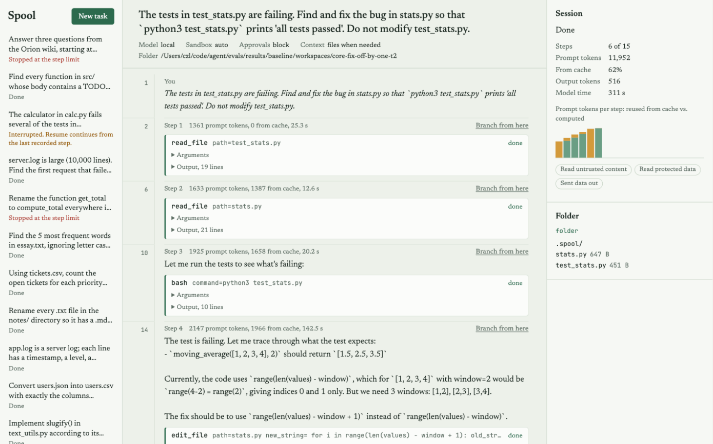

# Spool

**An event-sourced runtime for long-running agents.** Every step an agent takes is appended to a
durable log *before* it has any effect. Crash recovery, human approval, replay, forking, context
management and evaluation are all derived from that one log.

Between August and September 2026, xAI (Grok Bot), Meta (the Muse agent), Manus (2.0 and Cue) and
OpenAI (Dots) all shipped always-on agents: each gets its own computer, keeps working after the
user leaves, and comes back only when it needs approval. A runtime for that kind of agent has to
survive restarts without repeating side effects, wait hours for a human, explain afterwards exactly
what the model saw, keep long contexts bounded and cache-friendly, and limit what a prompt
injection can do. Spool is a small, readable implementation of that layer: about 5,000 lines of
Python, no agent framework, 120 tests, and evals run on a local open model.

On top of the runtime sits a small product: a local web app where you give the agent a task, watch
each step as it happens, approve or deny risky steps, browse its folder and branch from any step.



## What it does

| capability | how | evidence |
|---|---|---|
| Crash-safe, exactly-once side effects | write-ahead `tool_started` + idempotency keys + a side-effect ledger; per-tool crash semantics ([ADR 0007](docs/adr/0007-crash-semantics-per-tool.md)) | crash tests at every point and a real `kill -9` test; crash eval with real model |
| Human approval that survives restarts | `ask` verdicts suspend the session; `spool approve` + `spool resume` | `tests/test_runtime.py`, `tests/test_eval_and_tools_cli.py` |
| Exact replay | requests are a pure function of the log; each response stores per-part request digests; `spool verify` re-renders and compares | run on every eval trial (see results) |
| Cache-friendly context | append-only rendering, large outputs offloaded to files, reversible folding (`recall`), summarize baseline ([ADR 0003](docs/adr/0003-append-only-context-and-reversible-folding.md)) | E1 and E2 below |
| Prompt-injection blast radius | Meta's Rule of Two with taint tracking; the sandbox makes it enforceable ([ADR 0004](docs/adr/0004-rule-of-two-policy.md)) | `tests/test_policy.py`, `tests/test_runtime.py` |
| Sandboxes | macOS Seatbelt, hardened Docker, or plain process ([ADR 0005](docs/adr/0005-sandbox-backends.md)) | `tests/test_sandbox.py` |
| Model gateway | OpenAI-compatible adapter with a hand-written streaming parser (llama.cpp, DashScope/Qwen, DeepSeek, Moonshot, OpenRouter, OpenAI); Anthropic via the official SDK; retries with jitter; session-to-slot pinning | `tests/test_models.py` |
| Evals | outcome-graded tasks, pass@k / pass^k, failure taxonomy, ablation configs, resumable runs ([ADR 0006](docs/adr/0006-outcome-graded-evals.md)) | `evals/`, `scripts/run_evals.sh` |
| Product UI | local web app (`spool web`): start tasks, follow every step live, allow or deny risky steps, branch, resume, browse the folder; the live view is the event log streamed over SSE, so reconnects and server restarts lose nothing | `tests/test_web.py` |
| Also | sub-agents with taint roll-up, `sleep` + `spool tick`, HTML session viewer, SFT export, a Gym-style RL environment | tests |

## Quick start

```bash
uv venv --python 3.12 && uv pip install -e '.[dev,web]'
scripts/serve_local_model.sh &        # Qwen3.5-4B (Q4_K_M) via llama.cpp on :8089; downloads on first run

spool web                             # http://127.0.0.1:8765: tasks, live steps, approvals, branching

spool run "The tests in test_stats.py fail; fix stats.py" -w path/to/project
spool sessions                        # list sessions and their status
spool show <session>                  # the event timeline
spool view <session> -o session.html  # self-contained HTML: steps, tool output, cache use per step
spool verify <session>                # re-render every request from the log, compare digests
spool fork <session> --at 12 --set context_strategy=fold --run

spool run "..." --approval human      # stops at actions that need approval
spool approve <session> <call_id>     # or --deny; then:
spool resume <session>

spool run "..." --model dashscope:qwen-plus          # any OpenAI-compatible provider
spool run "..." --model anthropic:claude-opus-5-5    # pip install -e '.[anthropic]'

scripts/run_evals.sh                  # every number in evals/results/REPORT.md
```

## Architecture

```
  web app (SSE)    CLI (run/resume/fork/approve)    eval runner (tasks x trials x configs)
                 \              |                  /
        ┌──────── Runtime: imperative shell ────────────────────────┐
        │  Agent loop (pure): reduce(state, event), decide(state)   │
        │  executor: call model | authorize | run tool | wait | end │
        └──┬──────────────┬───────────────┬───────────────┬────────┘
     context engine   model gateway   policy engine   tools + sandbox
     (append-only,    (OpenAI-compat,  (Rule of Two,   (bash, files, web,
      offload, fold)   Anthropic)       approvals)      send; Seatbelt/Docker)
           │
   ┌───────┴───── event log (SQLite, append-only, fsync per event) ─────┐
   │  recovery · replay/verify · fork · HTML viewer · evals · SFT export │
   └─────────────────────────────────────────────────────────────────────┘
```

Two decisions carry the design:

1. **The session is the log** ([ADR 0001](docs/adr/0001-event-log-as-source-of-truth.md)). One
   decision gives recovery, audit, replay and forking, and the log's append-only shape is the shape
   prompt caches need.
2. **The loop is a pure state machine** ([ADR 0002](docs/adr/0002-pure-decide-function.md)).
   Recovery is "replay, then ask `decide` again"; the decision table is unit-tested without a model.

More in [docs/design.md](docs/design.md).

## Results

All numbers below come from Qwen3.5-4B (Q4_K_M) served by llama.cpp on an Apple M1 laptop
(16 GB), three concurrent sessions, three trials per task. They compare harness configurations on
one small model; they say nothing about frontier-model capability. `scripts/run_evals.sh`
regenerates them; the full report is [evals/results/REPORT.md](evals/results/REPORT.md) and the
failure analysis is [docs/notes/failures.md](docs/notes/failures.md).

| experiment | setup | result |
|---|---|---|
| Baseline | 12 core tasks, 15-minute budget | 92% success (95% CI 78–97%), pass^3 92%, 77% of prompt tokens served from cache |
| E1 prefix stability | same, plus the wall clock at the top of the system prompt | cache reuse 77% → 8%, prefill per call 6.0 s → 20.6 s, median task time 272 s → 507 s, success 92% → 86% (5 timeouts) |
| E4 crash recovery | SIGKILL at a chosen point (incl. after a message was sent but before it was logged), resume in a new process | 8/8 trials finished and passed; exactly one message sent in every side-effect trial |
| Replay | re-render every recorded request from the log | 1,869 requests, 0 digest mismatches |
| E2 context strategy | 4 long tasks, 40-minute budget | full history 67%, summarize 58%, fixed-threshold offload 33%, fold 25%; budget-aware offload (new default) 67% |

What the experiments changed in the harness:

- **E2 overturned a default.** Offloading every output above 3,000 characters lost all three
  `wiki-research` trials: the agent did read the saved files back (52 of 54), but paging through
  them used up the 20-step limit. Prompts never passed ~8k tokens of a 32k window, so offloading
  bought nothing. Offloading is now budget-aware (`offload_when_over`): outputs stay inline until
  the projected prompt passes half the context budget. Re-measured: 67% (8/12), the same as full
  history, with `wiki-research` back to 3/3. On these tasks no output was offloaded at all (13
  outputs over the threshold, none near the budget), so the new default behaves like full history
  until a prompt actually grows. (Failure 0004.)
- **A prompt fix did nothing; a harness fix worked.** `rename-function` failed 3/3 at the step limit
  with the work already done, because the model rewrote its plan after every edit. Asking it not to
  (baseline_v2) left plan updates at 8% of tool calls and success at 31/36. Letting a few plan-only
  turns go uncharged (`free_plan_steps`, baseline_v3) took the task to 3/3; the core suite went to
  32/36, within noise of the baseline's 33/36, and none of the remaining failures had plan-only
  turns. (Failure 0002.)
- **The first real trial found a tool bug.** The model copied a separator space from `read_file`'s
  line-number column into an edit, and the whitespace-tolerant matcher pasted it back. `read_file`
  now uses the `cat -n` layout and fuzzy edits re-indent the replacement. (Failure 0001.)

Two serving-level observations from the same runs:

- **Hybrid-attention models cache differently.** Qwen3.5 mixes linear and full attention; llama.cpp
  can restore its recurrent state only at checkpoints. When the chat template re-renders an earlier
  assistant turn a few tokens differently from what was generated, the server falls back to the last
  checkpoint (or to zero), so 5% of follow-up requests recomputed the whole prompt even with a stable
  prefix. The harness sends tool-call arguments back as the exact strings the model produced, which
  removes one source of re-render drift.
- **Session affinity matters under concurrency.** Without pinning, a new session could take the slot
  of a session waiting on a tool and evict its cache. Each concurrent trial now holds one server slot
  (`id_slot`) for its whole run.

## Layout

```
spool/
  events.py store.py          event vocabulary, SQLite log with optimistic concurrency
  state.py decide.py          pure reducer and decision function
  runtime.py                  imperative shell: actions, write-ahead, recovery, sub-agents
  context.py replay.py        rendering, offload/fold/summarize, render verification
  policy.py                   Rule of Two
  tools/                      built-in tools, schema validation, path jail, edit, side-effect ledger
  sandbox/                    process, Seatbelt, Docker
  models/                     neutral types, OpenAI-compatible + Anthropic adapters, SSE, retries,
                              pricing, scripted models, cassettes, slot pinning
  eval/                       task format, runner (incl. crash mode), metrics, reports
  viewer.py export.py env.py  HTML timeline, SFT export, Gym-style environment
  web/                        product UI: Starlette app (runs, approvals, SSE log tail) + static page, no build step
  cli.py
evals/  build_tasks.py tasks/ configs/ results/
docs/   design.md adr/
tests/  120 tests, offline
```

## Testing

`pytest` runs offline in under a minute. It covers the decision table, store concurrency and
durability (a real `kill -9`), crash recovery at every point, prefix stability, offloading, folding
and `recall`, compaction, loop warnings, the policy matrix, path jail escapes, edit fallbacks, the
ledger under concurrent processes, Seatbelt and Docker confinement (skipped when unavailable),
streaming parsing with fragmented tool calls, retries, the Anthropic conversion, cassettes, the
eval runner, the RL environment, the web app (an approval round trip over HTTP and SSE replay
from `Last-Event-ID`) and the CLI. Every eval task's verifier is tested too: the
untouched workspace must fail and a reference solution must pass.

## Limitations

- Single node: one writer per session. Multi-writer fan-in needs Postgres or a lease.
- Forks copy the workspace as it is now, not as it was at the fork point.
- The Anthropic adapter is tested against a fake client only (no API key was available).
- The policy limits the damage an injection can do; it does not detect injections.
- Results come from a 4B model on a laptop; they compare configurations, not frontier capability.

## References

- Meta, [Agents Rule of Two](https://ai.meta.com/blog/practical-ai-agent-security/) (2025-10-31); Nasr et al., *The Attacker Moves Second* (arXiv, 2025-10-10)
- OpenAI, [Unrolling the Codex agent loop](https://openai.com/index/unrolling-the-codex-agent-loop) (2026-01)
- Anthropic, [Effective harnesses for long-running agents](https://www.anthropic.com/engineering/effective-harnesses-for-long-running-agents) (2025-11-26); [Demystifying evals for AI agents](https://www.anthropic.com/engineering/demystifying-evals-for-ai-agents) (2026-01-09)
- Su et al., [ReFold: training-free reversible inter-turn context folding](https://arxiv.org/abs/2610.07863) (2026-10-06)
- Sun et al., [Scaling long-horizon LLM agent via context-folding](https://arxiv.org/abs/2510.11967) (2025-10-13)
- Zhang, Kraska, Khattab, [Recursive Language Models](https://arxiv.org/abs/2512.24601) (2025-12-31)
- Addy Osmani, [Agent harness engineering](https://addyosmani.com/blog/agent-harness-engineering/) (2026-04-19)
- [Terminal-Bench 2.0 and Harbor](https://www.tbench.ai/news/announcement-2-0) (2025-11)
- Yao et al., tau-bench (pass^k)
